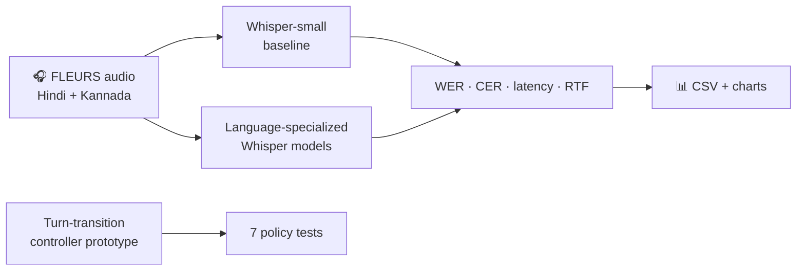

<div align="center">


[](https://colab.research.google.com/drive/1GqasiGGlLbPUYyKf6NDzyu1l1kQ9VLwr?usp=sharing)
[](https://www.python.org/)
[](https://huggingface.co/datasets/google/fleurs)
[](https://huggingface.co/datasets/google/fleurs)
[](#honest-status-report)

### 🎙️ A little lab for speech that listens fast.
**Compare the architectures. Test the transcripts. Measure the delay.**

Built by [@vrbeirer](https://github.com/vrbeirer) · [Open the Colab notebook ↗](https://colab.research.google.com/drive/1GqasiGGlLbPUYyKf6NDzyu1l1kQ9VLwr?usp=sharing)

</div>

---

## 🧪 What's this project?

Speech AI has a tricky job: understand what someone said, respond usefully, and avoid making them wait. **SIGNAL // INDIC** looks at that problem from two sides:

- **Research:** compare [Moshi](https://arxiv.org/abs/2410.00037) with [SALMONN-omni](https://proceedings.neurips.cc/paper_files/paper/2025/hash/233aee920dab065709145371b5900b8f-Abstract-Conference.html).
- **Experiment:** test Hindi and Kannada speech recognition, compare error rates and latency, and exercise a tiny turn-transition controller prototype.

> **Research question:** What architectural limitations prevent Speech LLMs from achieving low-latency, natural, real-time conversations?

## ⚡ The pipeline, at a glance



<table>
<tr>
<td width="33%" align="center">
<h3>🗣️ 100 clips</h3>
50 Hindi + 50 Kannada examples from the FLEURS test split.
</td>
<td width="33%" align="center">
<h3>📏 4 core metrics</h3>
WER, CER, inference latency, and real-time factor (RTF).
</td>
<td width="33%" align="center">
<h3>🧭 7/7 tests</h3>
Predefined cases passed for the rule-based controller prototype.
</td>
</tr>
</table>

## 📊 Results dashboard

These charts reflect the **saved notebook run** on 100 examples. Lower WER/CER and lower latency are better.

<details open>
<summary><b>Recognition errors · WER ↓</b></summary>


</details>

<details open>
<summary><b>Inference time · seconds per audio example ↓</b></summary>


</details>

<details>
<summary><b>Saved metrics (exact values)</b></summary>

| Language | Model condition | WER ↓ | CER ↓ | Mean latency ↓ | Mean RTF ↓ |
|---|---|---:|---:|---:|---:|
| Hindi | Whisper-small baseline | 0.5298 | 0.3603 | 2.50 s | 0.241 |
| Hindi | Language-specialized Whisper | 0.0396 | 0.0199 | 21.07 s | 1.965 |
| Kannada | Whisper-small baseline | 2.0571 | 1.3348 | 7.63 s | 0.689 |
| Kannada | Language-specialized Whisper | 0.0662 | 0.0371 | 23.07 s | 1.860 |
| **Overall** | **Whisper-small baseline** | **1.3398** | **0.8852** | **5.07 s** | **0.465** |
| **Overall** | **Language-specialized Whisper** | **0.0537** | **0.0292** | **22.07 s** | **1.912** |

</details>

### 🧠 What the numbers suggest

In this saved run, the language-specialized models show much lower transcription error rates, but they take considerably longer. The overall specialist-model RTF is **1.912**, above real time.

**A research caveat, not fine print:** some baseline predictions showed script/decoding anomalies and repetitions. Treat this small run as exploratory evidence—not a definitive or universally fair benchmark. The charts visualize the notebook's saved metrics; they don't hide that limitation.

## 🚀 Run it yourself

1. Open the notebook in [Google Colab](https://colab.research.google.com/drive/1GqasiGGlLbPUYyKf6NDzyu1l1kQ9VLwr?usp=sharing).
2. Choose **Runtime → Change runtime type → T4 GPU** (or another available GPU).
3. Run the cells from top to bottom. The first run downloads datasets and model checkpoints, so allow time and storage for the downloads.
4. Download `task2_results.zip` from the last cell.

The notebook exports sample-level predictions, a metrics summary, charts, controller test results, and checkpoint files. Colab's `/content` storage is temporary—download the ZIP before closing the session.

## 🧩 The architecture story

| Moshi | SALMONN-omni |
|---|---|
| Mimi audio codec + joint speech/text token streams + Temporal/Depth Transformers. | Mamba streaming encoder + LLM adapters + a separate streaming speech synthesizer. |
| Tight joint audio modelling; substantial training and per-frame generation work. | Reuses a pretrained text LLM; needs careful coordination between language generation and synthesis. |

The paper compares both designs across seven architectural dimensions, includes architecture diagrams, and proposes a **latency-aware adaptive turn-transition controller**. The notebook contains a small rule-based controller prototype; it is **not** a full integration into Moshi or SALMONN-omni and is not validated for live conversation.

## 🛠️ What's in the repo?

```text
indic-speech-llm-latency-lab/
├── README.md
├── Task2_Indic_Speech_Evaluation_Colab.ipynb
├── assets/
│   ├── signal-wave.gif
│   ├── wer-comparison.png
│   └── latency-comparison.png
└── reports/  # optional: place the PDF report here
```

## 🔬 Honest status report

- ✅ 100-example Hindi/Kannada evaluation run saved.
- ✅ WER, CER, latency, RTF, and comparison charts generated.
- ✅ Seven predefined controller policy tests passed.
- ⚠️ Baseline decoding anomalies mean the numerical comparison should be interpreted cautiously.
- ⚠️ The controller is a prototype. Its effect on genuine streaming conversations has not been established.

## 📚 Research & model links

- [Moshi paper](https://arxiv.org/abs/2410.00037) · [Moshi implementation](https://github.com/kyutai-labs/moshi)
- [SALMONN-omni paper](https://proceedings.neurips.cc/paper_files/paper/2025/hash/233aee920dab065709145371b5900b8f-Abstract-Conference.html)
- [Google FLEURS dataset](https://huggingface.co/datasets/google/fleurs)
- [Whisper-small](https://huggingface.co/openai/whisper-small)
- [Hindi Whisper Large-v2](https://huggingface.co/vasista22/whisper-hindi-large-v2) · [Kannada Whisper Medium](https://huggingface.co/vasista22/whisper-kannada-medium)

---

<div align="center">

**LISTEN → TRANSCRIBE → MEASURE → DECIDE**

<sub>Less waiting. Better evidence. Smarter turn-taking.</sub>

</div>
