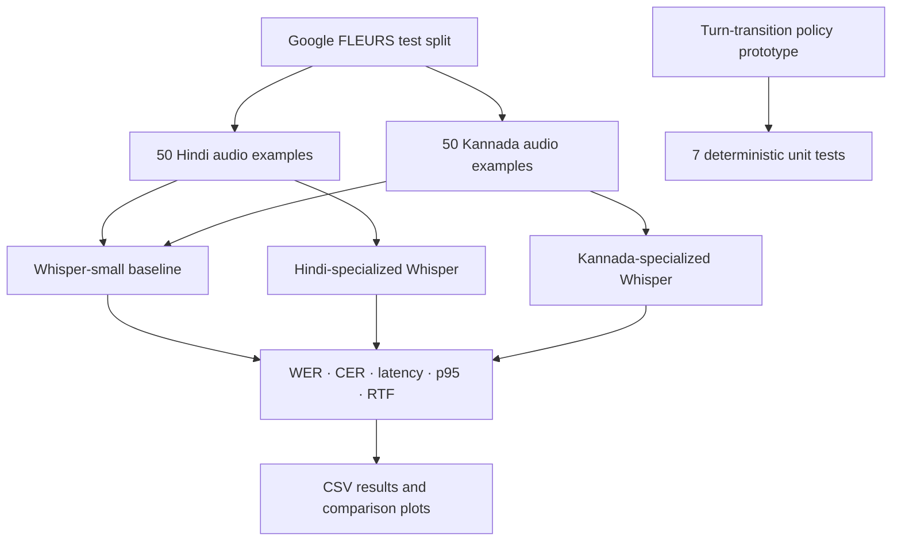

# indic-speech-llm-latency-lab
Comparative analysis of Moshi and SALMONN-omni, with Hindi and Kannada speech recognition experiments, latency evaluation, and a turn-transition controller prototype.

<div align="center">

# ◈ SIGNAL // INDIC
### Speech Intelligence · Latency · Turn-Taking

**From audio to evidence.** A research notebook exploring how speech systems trade recognition quality for response time—and why knowing *when to respond* matters as much as knowing *what was said*.

[](https://colab.research.google.com/github/YOUR_GITHUB_USERNAME/indic-speech-llm-latency-lab/blob/main/Task2_Indic_Speech_Evaluation_Colab.ipynb)


**Core loop:** `SPEECH → TRANSCRIPTION → MEASUREMENT → DECISION`

</div>

---

## The research question

> **What are the main architectural limitations preventing Speech LLMs from achieving low-latency, natural, real-time conversations?**

This project studies two complementary angles:

1. **Architecture:** a comparative analysis of [Moshi](https://arxiv.org/abs/2410.00037) and [SALMONN-omni](https://proceedings.neurips.cc/paper_files/paper/2025/hash/233aee920dab065709145371b5900b8f-Abstract-Conference.html), including their streaming designs, representation choices, latency trade-offs, and turn-taking mechanisms.
2. **Experiment:** an executable Hindi/Kannada speech-recognition evaluation, plus a small rule-based prototype for latency-aware turn transitions.

The accompanying research paper contains the full comparative analysis and three architecture/proposal diagrams. The notebook is the reproducible implementation component.

## What is inside

| Component | What it does | What it does **not** claim |
|---|---|---|
| **Architecture review** | Compares Moshi and SALMONN-omni across seven architectural dimensions. | It is not a reimplementation of either foundation model. |
| **Indic ASR evaluation** | Evaluates 50 Hindi and 50 Kannada examples from the FLEURS test split. | It is not a broad benchmark across every Indian language or accent. |
| **Model comparison** | Compares `openai/whisper-small` with language-specialized Hindi and Kannada Whisper checkpoints. | A single 100-example run does not establish universal model superiority. |
| **Latency measurements** | Records per-example inference latency, p95 latency, and real-time factor (RTF). | Notebook inference latency is not end-to-end conversational latency. |
| **Turn-transition controller** | Implements a deterministic policy prototype and tests seven predefined decision cases. | The controller is not integrated into live streaming ASR and the tests do not measure real-world turn-taking accuracy. |
| **Optional speech-to-answer demo** | Connects transcription with `Qwen2.5-1.5B-Instruct` to demonstrate a basic answer-generation path. | This is a demo, not a scored question-answering benchmark. |

## System map



## Experimental setup

### Dataset

- **Dataset:** [Google FLEURS](https://huggingface.co/datasets/google/fleurs)
- **Split:** `test`
- **Languages:** Hindi (`hi_in`) and Kannada (`kn_in`)
- **Sample count:** 100 total — 50 per language
- **Sampling:** the notebook shuffles each language split with seed `42`, then selects 50 examples
- **Audio processing:** resampled to 16 kHz by the dataset loader

### Models

| Role | Checkpoint | Purpose |
|---|---|---|
| Baseline | [`openai/whisper-small`](https://huggingface.co/openai/whisper-small) | General multilingual ASR comparator |
| Hindi specialist | [`vasista22/whisper-hindi-large-v2`](https://huggingface.co/vasista22/whisper-hindi-large-v2) | Hindi-focused transcription condition |
| Kannada specialist | [`vasista22/whisper-kannada-medium`](https://huggingface.co/vasista22/whisper-kannada-medium) | Kannada-focused transcription condition |
| Optional answer generator | [`Qwen/Qwen2.5-1.5B-Instruct`](https://huggingface.co/Qwen/Qwen2.5-1.5B-Instruct) | Demonstrates response generation from a transcript |

### Metrics

- **WER — Word Error Rate:** word-level transcription errors relative to the reference; lower is better.
- **CER — Character Error Rate:** character-level transcription errors relative to the reference; lower is better.
- **Mean / p95 latency:** typical and high-percentile per-example ASR inference time, in seconds.
- **RTF — Real-Time Factor:** processing time divided by audio duration. An RTF greater than `1.0` means inference took longer than the duration of the audio.

## Results from the saved notebook run

The following values are reproduced from the notebook's saved metric output. They describe **this particular 100-example run**, not a universal performance guarantee.

| Language | Condition | Examples | WER ↓ | CER ↓ | Mean latency (s) ↓ | p95 latency (s) ↓ | Mean RTF ↓ |
|---|---|---:|---:|---:|---:|---:|---:|
| Hindi | Whisper-small baseline | 50 | 0.5298 | 0.3603 | 2.502 | 6.484 | 0.241 |
| Hindi | Language-specialized Whisper | 50 | 0.0396 | 0.0199 | 21.070 | 41.037 | 1.965 |
| Kannada | Whisper-small baseline | 50 | 2.0571 | 1.3348 | 7.630 | 8.521 | 0.689 |
| Kannada | Language-specialized Whisper | 50 | 0.0662 | 0.0371 | 23.072 | 45.192 | 1.860 |
| **Overall** | **Whisper-small baseline** | **100** | **1.3398** | **0.8852** | **5.066** | **8.506** | **0.465** |
| **Overall** | **Language-specialized Whisper** | **100** | **0.0537** | **0.0292** | **22.071** | **41.847** | **1.912** |

### Interpreting the results responsibly

In the saved run, the language-specialized models produced substantially lower WER/CER, but their mean latency was also much higher. Their overall mean RTF of `1.912` is above real time, so the accuracy result should not be described as a low-latency win.

**Important evaluation caveat:** the saved baseline outputs visibly contain script/decoding anomalies (including Urdu-script output on some Hindi examples and repeated characters in some Kannada examples). The comparison should therefore be treated as an exploratory diagnostic run, not a definitive head-to-head benchmark until baseline decoding and output-language handling are independently validated. The metrics above are reported transparently as saved; they should not be generalized beyond this test subset.

## Reproduce the experiment

### Fastest path: Google Colab

1. Open the notebook in this repository. Use the **Open in Colab** badge at the top of this README after replacing `YOUR_GITHUB_USERNAME` with your GitHub username.
2. In Colab, select **Runtime → Change runtime type → T4 GPU** (or another available GPU).
3. Run the notebook cells **from top to bottom**. The first run downloads the dataset and model checkpoints; this can take time and require several gigabytes of storage/memory.
4. Wait for the transcription evaluation, metric table, plots, and controller unit tests to finish.
5. Download `task2_results.zip` from the notebook's final cell.

The notebook installs its Python dependencies in its setup cell. A GPU is strongly recommended; CPU execution may be much slower.

### Outputs

The notebook writes outputs under `/content/task2_results_specialist/` and packages available files into `/content/task2_results.zip`. The output set includes:

- `task2_asr_results.csv` — sample-level references, predictions, and timing values
- `task2_metrics_summary.csv` — WER, CER, latency, p95 latency, and RTF summary
- `controller_unit_tests.csv` — seven predefined controller cases and pass/fail results
- PNG charts comparing WER, CER, and mean latency
- checkpoint CSV files written during evaluation

Colab's `/content` directory is temporary. Download the ZIP before closing or resetting the runtime.

## Turn-transition controller: prototype, not a deployed feature

The notebook includes a lightweight policy based on speech activity, silence duration, a semantic-confidence input, elapsed waiting time, remaining latency budget, and interruption state. It can return one of four actions:

- `continue_listening`
- `respond`
- `continue_speaking`
- `yield_turn`

The seven hand-designed tests verify these policy branches; the saved notebook reports **7/7 tests passed**. This confirms the expected outputs for those test cases only. It does not establish that semantic confidence is calibrated, that the controller improves live dialogue, or that it reduces end-to-end latency. Those questions require a streaming integration and a separately annotated conversation test set.

## Repository layout

Recommended structure:

```text
indic-speech-llm-latency-lab/
├── README.md
├── Task2_Indic_Speech_Evaluation_Colab.ipynb
└── reports/                     # optional, if you want the PDF mirrored here
    └── Speech_LLM_Comparative_Report.pdf
```

The submission instructions ask for a PDF report and a repository link containing code plus reproduction instructions. The PDF can be attached to the email separately; mirroring it in `reports/` is optional. Rename your final notebook to `Task2_Indic_Speech_Evaluation_Colab.ipynb` when uploading so the repository stays easy to navigate.

## Research paper: architecture comparison

The companion report compares:

- **Moshi:** Mimi codec tokens and hierarchical Temporal/Depth Transformer modelling for joint speech-text interaction.
- **SALMONN-omni:** a Mamba-based streaming speech encoder, LLM adapters, an LLM backbone, and a separate streaming synthesizer with explicit turn-state tokens.
- **Proposed direction:** a latency-aware turn-transition controller that considers semantic-completeness confidence, speech context, and a latency budget.

The controller is presented as a testable research proposal. The notebook's rule-based controller is a small prototype related to that idea, not a full implementation of the proposed mechanism inside Moshi or SALMONN-omni.

## Limitations and next experiments

- Expand beyond 100 samples and repeat runs to estimate variability.
- Validate language/script handling for the baseline before drawing strong comparisons.
- Add human review of transcripts and stratified tests for noise, accents, speaking rates, and disfluencies.
- Score question-answer correctness on a separate dataset with reference answers; FLEURS transcript references alone are not enough for that evaluation.
- Evaluate turn-transition behaviour on annotated multi-turn audio, then integrate the controller with a live streaming pipeline.
- Measure complete end-to-end response time before making real-time conversational claims.

## References and model sources

1. Défossez et al., [*Moshi: A Speech-Text Foundation Model for Real-Time Dialogue*](https://arxiv.org/abs/2410.00037).
2. Yu et al., [*SALMONN-omni: A Standalone Speech LLM without Codec Injection for Full-Duplex Conversation*](https://proceedings.neurips.cc/paper_files/paper/2025/hash/233aee920dab065709145371b5900b8f-Abstract-Conference.html).
3. Google, [FLEURS dataset card](https://huggingface.co/datasets/google/fleurs).
4. OpenAI, [Whisper-small model card](https://huggingface.co/openai/whisper-small).
5. [Hindi Whisper Large-v2 model card](https://huggingface.co/vasista22/whisper-hindi-large-v2).
6. [Kannada Whisper Medium model card](https://huggingface.co/vasista22/whisper-kannada-medium).
7. Qwen, [Qwen2.5-1.5B-Instruct model card](https://huggingface.co/Qwen/Qwen2.5-1.5B-Instruct).

Please follow the individual dataset and model-card licenses and terms. This repository does not claim ownership of the pretrained models or the FLEURS data.

---

<div align="center">

**SIGNAL // INDIC**  
*Measure the delay. Inspect the failure. Make the next decision smarter.*

</div>
